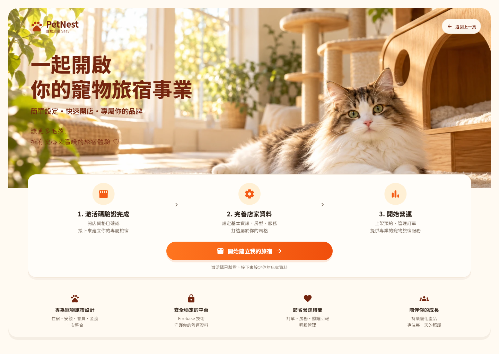
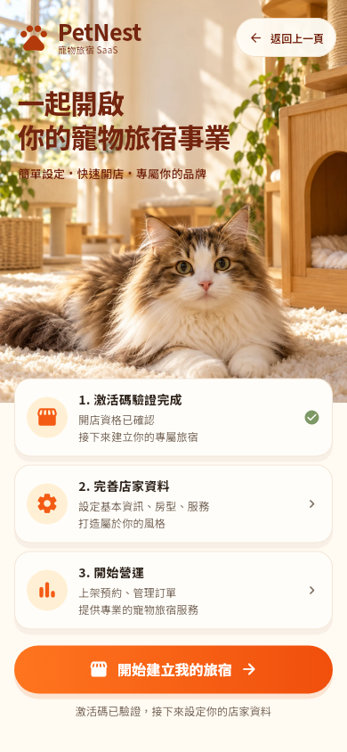
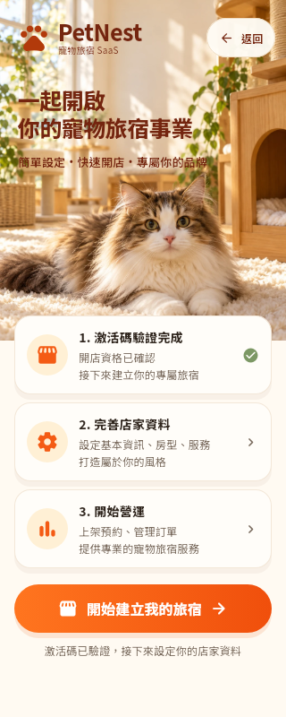

# PetNest 開店歡迎頁 v2：實作與驗證

專用分支：[feature/shop-opening-welcome-v2](https://github.com/aac5881500-commits/petnest_saas/tree/feature/shop-opening-welcome-v2)

基礎 main：`3ca2d77b7a49927155070dda1cf04f108c645568`。本次所有遠端寫入均透過 GitHub 連接器，沒有使用終端機 Git Push，沒有更新或合併 main，也沒有部署 Firebase。

## 分階段保存

| 階段 | Commit | 遠端核對 |
| --- | --- | --- |
| 建立分支 | 以最新 main 為基礎，沒有新增 Commit | 搜尋分支並讀取原始歡迎頁成功 |
| 正式圖片 | `3207cfa61de44d4e07fc18902983b5cfd09408e7` | 兩張 WebP 從分支讀回，Base64 內容與本機完全一致 |
| Flutter 實作 | `0113126dd1854022a2ff92209ff342a5b20b4093` | 歡迎頁與 pubspec.yaml 從分支讀回，文字內容完全一致 |
| 測試與必要修正 | 請查看此檔案的提交紀錄 | 含最終字重修正、測試、三張實際 Flutter 截圖與此紀錄 |

## 本次完整檔案清單

- `lib/features/auth/pages/shop_opening_welcome_page.dart`
- `pubspec.yaml`
- `assets/images/shop_onboarding/welcome_desktop.webp`
- `assets/images/shop_onboarding/welcome_mobile.webp`
- `test/shop_opening_welcome_page_test.dart`
- `test/shop_activation_code_page_test.dart`
- `test/shop_opening_welcome_screenshot_test.dart`
- `test/support/shop_opening_welcome_preview.dart`
- `test/goldens/shop_opening_phone_320.png`
- `test/goldens/shop_opening_phone_390.png`
- `test/goldens/shop_opening_desktop_1440.png`
- `docs/shop_opening_welcome_v2.md`

沒有新增相依套件、修改 pubspec.lock 或分析設定。激活碼頁的正式程式、建立店家頁與後端安全檢查均未修改；激活碼頁測試只更新對歡迎頁的判斷。

## 實作內容

- 桌機：大型暖陽貓旅宿照片、左上品牌、深棕大標與副標、三步驟橫向卡片、卡片內橘色主要按鈕、產品特色列。最大內容寬 1440，可在 1280～1920 寬螢幕使用。
- 手機：獨立直式照片、直向步驟卡片、明顯主按鈕與返回。支援 SafeArea、窄手機與文字放大，文字放大時讓照片往下配置，優先保留文字閱讀空間。
- 圖片是本機 Image.asset；按鈕、文字與卡片都由 Flutter 元件繪製，沒有把整張設計圖當作 UI。
- NotoSansTC 明確指定 wght 軸，解決此環境第一輪截圖字重過細的問題。沿用現有字體檔，不新增套件或字體資產。
- 主視覺採 450ms 淡入，遵守減少動態效果設定。

## 正式素材

| 檔案 | 格式與尺寸 | 大小 | Git blob SHA |
| --- | --- | --- | --- |
| welcome_desktop.webp | WebP，1774×887 | 180,384 bytes | 6c9979d89d653e191676ff6bb970bf0645922e93 |
| welcome_mobile.webp | WebP，1024×1536 | 194,906 bytes | 22b6aa8c36eb9762793617f9cbc33c64924a42a3 |

兩張照片使用內建 imagegen 生成，轉為 WebP quality 90。已實際開啟並解碼，沒有文字、Logo 或 UI，也不依賴外部圖片網址。兩張合計約 367 KiB。

## 原有流程

保留「我的店家 → 輸入激活碼 → 後端驗證成功 → 歡迎頁 → 建立店家」。

歡迎頁不再次要求激活碼、不重新驗證或寫入 Firebase。主要按鈕仍將 trim 後的 activationCode 傳入原 CreateShopPage。保留返回、created／recheckActivation 結果回傳與空激活碼要求重新驗證的行為，並防止連點開啟重複表單。

## 已執行驗證

環境：官方 Flutter 3.38.4，Dart 3.10.3，Linux。使用專案原 pubspec.lock，鎖定檔沒有差異。

2026-10-24 Windows 補驗：同為 Flutter 3.38.4／Dart 3.10.3，歡迎頁、主題、字體及原有基準均未變更。全套與單獨重跑時，與 Linux 基準的差異集中於字形、圖示及返回按鈕少量邊緣；逐張檢視 320／390／1440 寬度，照片、卡片、換行與主要按鈕位置一致，沒有遮擋或裁切。保留原有 Linux PNG，將此次實際測試輸出的三張 Windows 圖另存為 `test/goldens/windows/shop_opening_*.png`。截圖測試在 Windows 選用此目錄，其他平台沿用原路徑；維持預設逐像素比對，沒有放寬容差。字體均由專案資產載入並等待完成後截圖；日後更新基準應在對應平台執行並逐張檢視。

| 檢查 | 結果 |
| --- | --- |
| 本次 5 個 Dart 檔案 Analyze | No issues found |
| 全專案 Flutter Analyze | 0 errors、9 warnings、219 infos，共 228 項；皆在本次修改範圍外，命令仍因現有診斷以非零狀態結束 |
| 相關測試 | 30 項全部通過，包含不更新 golden 基準的重跑 |
| 資產載入／解碼 | 桌機與手機 WebP 正常 |
| 排版 | 320、390、430、768、900、1280、1440、1920 寬度測試通過 |
| 文字放大 | 320／1440 寬度的 2 倍文字測試通過 |
| SafeArea | 手機上下系統區域測試通過 |
| 導航 | 返回、激活碼傳遞、連點保護、建立結果回傳及空碼處理通過 |
| Flutter Web | 專用本機驗證入口成功編譯 |
| git diff --check | 通過 |

執行命令：

```text
flutter analyze --no-pub
flutter analyze --no-pub lib/features/auth/pages/shop_opening_welcome_page.dart test/shop_opening_welcome_page_test.dart test/shop_activation_code_page_test.dart test/shop_opening_welcome_screenshot_test.dart test/support/shop_opening_welcome_preview.dart
flutter test --no-pub test/shop_opening_welcome_page_test.dart test/shop_activation_code_page_test.dart test/shop_opening_welcome_screenshot_test.dart --reporter expanded
flutter build web --no-pub --no-web-resources-cdn --target test/support/shop_opening_welcome_preview.dart
git diff --check
```

Web 編譯的是獨立驗證入口，不是正式 main.dart；未初始化 Firebase、登入或建立正式店家。

## 實際 Flutter 截圖

以下是 Flutter 測試引擎使用正式照片及字體渲染的 PNG，已逐張檢視；不是設計稿、HTML 仿製或瀏覽器截圖。截圖也與程式碼一起保存在 GitHub。

桌機 1440×1024：



一般手機 390×844：



窄手機 320×800：



## 尚未驗證與設計差異

- 此環境 Unix socket 建立回傳 Operation not permitted，未完成本機瀏覽器實際畫面與互動驗收。
- 未完成 Android／iOS 實機測試、正式登入到建立店家的端對端測試；沒有測試正式資料寫入。
- 圖片是重新生成的寫實場景，貓咪、貓屋與植物位置和參考圖不同。
- 第一個步驟顯示「激活碼驗證完成」，主要按鈕是「開始建立我的旅宿」，避免已驗證後重複輸入激活碼。
- 品牌使用 Flutter 爪印與文字，未複製參考圖客製 Logo、額外導覽、聯絡連結及裝飾腳印。
- 真實裝置的字型抗鋸齒、陰影與 SafeArea 效果仍需複驗。

正式 Web 要套用此版，之後需重新建置正式入口並部署 Hosting；本次未部署。Android／iOS 需重新建置與測試。不涉及 Functions、Firestore Rules、Storage Rules 或 Indexes，也未修改訂單、金流、會員、安親或房務。

## 圖片生成提示詞

內建 imagegen，兩個獨立呼叫。

桌機：

```text
Use case: photorealistic-natural. Asset: premium cat hotel onboarding desktop hero photograph, landscape 2:1, 2048x1024 if possible. Scene: warm sunlight flooding a beautiful boutique cat hotel with cream walls, large bright windows, honey oak wooden cat house and sisal cat tree on the right, soft ivory rug, lush but restrained real green plants framing edges. Subject: a very cute real long-haired white and brown tabby cat lying comfortably in the lower RIGHT foreground, entire face and ears visible around the rightmost third, looking at camera with expressive eyes, realistic fur and anatomy. Include one distant soft-focus real cat on an upper cat perch if natural. Composition: lower foreground cat extends horizontally on rug, wooden house behind on right; LEFT 52% bright sunlit windows and cream interior with subtle physical detail and no distracting focal objects, ready for dark headline text later drawn by Flutter. Cat face around 70% across and 65% down. High-end editorial pet interior photography, inviting, naturally golden light, gentle depth of field, cream white, warm orange and wood brown palette. Real photography, no cartoon, no illustration, no vector, no blank artificial gradient. Absolutely no text, lettering, logo, watermark, UI, buttons, frames or collage. Make only the clean photograph.
```

手機：

```text
Use case: photorealistic-natural. Asset: vertical portrait photograph for a premium cat hotel mobile onboarding hero, 2:3 aspect ratio, 1024x1536. Warm sunlit boutique cat hotel with cream walls, bright natural windows, a honey oak wooden cat house at right middle, sisal cat tree, warm ivory soft rug and delicate green plants along the edges. A real extremely cute fluffy long-haired white and brown tabby cat lies on the rug in the LOWER half with its complete face and ears clearly visible, large eyes looking toward camera, natural realistic anatomy and fur. Compose the CAT EARS starting at 56% of full image height, face centered at 68% down, paws in bottom 15%. Upper 45% bright calm natural cream wall and window space with subtle light patterns, uncluttered enough for dark heading and branding that Flutter will draw later. Do not leave an artificial empty digital gradient. Same visual world as luxury warm wooden cat hotel editorial photography. Beautiful natural golden sunlight, photographic texture, premium and inviting, cream white / warm orange / honey brown palette. No text, no logo, no watermark, no interface, no buttons, no lettering, no frame, no collage, no cartoon, no illustration. Only a clean real-looking photograph.
```

